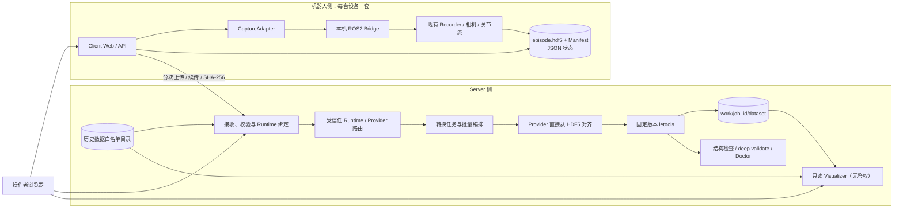

# BodyPipeline

**面向机器人遥操作采集、传输与 LeRobot 数据处理的 Client / Server 数据管线。**

BodyPipeline 在机器人端提供 Web 数采工作台，在服务器端统一完成原始数据接收、时间对齐、LeRobot v2.1 / v3.0 转换、质量检查和 Visualizer 预览。系统基于 [letools](https://github.com/XieWeikai/letools) 构建，采用 FastAPI + 原生 Web 页面、文件目录 + JSON 状态持久化，不需要数据库，也不要求前端构建。

[快速开始](#快速开始) · [系统架构](#系统架构) · [Server 工作台](#server-工作台) · [机器人适配](#机器人适配) · [文档](#文档)

> **当前状态：v0.1 / MVP。** 运行时聚焦主从臂遥操作，首批适配 AgileX ALOHA。机器人 Client 已使用单文件 `episode.hdf5` 封存和上传，Server 直接从 HDF5 对齐并交给 letools 转换；Client、Server、ROS2 Bridge 和 Viewer 已完成端到端联调与部署验证。不同机器人、相机布局、关节维度和操作语义仍需要按其真实接口完成适配，不能只修改 `robot_type` 后直接复用转换链。

## 核心能力

机器人 Client 已集成[AgileX 真机回放](docs/robots/agilex-replay.md)：可从已保留的 episode 直接进入，支持平台原始包、对齐 HDF5 与原工具 ALOHA HDF5，复用已有工具完成回放，提供进度、日志和停止。本地 Mock 演示支持模拟回放，不连接机器人。

回放采用独立的 [ReplayProvider 多机器人适配层](docs/robots/replay-adaptation.md)，与采集 Adapter、Server 转换 Provider 分工；当前真实实现为 AgileX ALOHA，其他机器人需接入对应执行接口。

Unitree G1（SONIC 1.1 / BrainCo）新增独立 raw subscriber 的 Client 适配：手柄 episode 自动同步、raw 原样封存、整批次采集优先的资源门控与断点上传。配置、限制和待现场验收项见 [G1 Client 使用说明](docs/robots/g1-client.md)；此适配不启动机器人控制服务，也不包含 G1 动作回放。

数据回放统一位于 Client 工作台侧栏（`/#replay`），与采集共用登录和页面布局，直接操作当前机器人。Server 仅负责接收、转换、质检与预览，不再提供回放转发接口。

| 能力 | 说明 |
| --- | --- |
| 机器人端 Web 采集 | 多相机预览、数据集选择、本地存储根与子目录、远端目标、开始 / 停止 / 保留 / 丢弃 |
| 任务数据集 | 相同任务描述归入同一 collection，每次采集作为新的 episode 追加 |
| 机器人接口隔离 | `CaptureAdapter` 统一采集契约，ROS2 Bridge 对接机器人现有采集服务 |
| 单文件 HDF5 上传 | AgileX ALOHA 采集封存为 `episode.hdf5`，分块传输、字节级断点续传、SHA-256、失败重试和持久化回执 |
| Server 批量转换 | 按机器人类型和数据集选择多个 episode，统一填写 instruction，一次转换成一个 LeRobot v2.1 / v3.0 数据集 |
| 已有数据集版本转换 | 从已转换、已导入或已合并的数据集中选择来源，使用 LeTools 在 v2.1 与 v3.0 之间双向转换并生成独立结果 |
| 时间对齐 | 固定输出帧率、有界相机最近帧、因果关节保持和逐 episode 诊断 |
| 质量检查 | 转换结构检查、LeRobot deep validate、11 项 LeRobot Doctor 检查 |
| 自动标注 | 用固定版本 Argus `review` 为已登记数据集生成逐 Episode 任务描述、事件与完成情况；独立队列、费用上限、取消与续跑 |
| 数据预览 | Server 页面直接启动无鉴权只读 Visualizer，支持多相机视频 Range |
| 历史数据导入 | 原地登记旧原始采集或已有 LeRobot 数据集，不复制、不移动、不改写 |
| 文件持久化 | 业务状态保存为 JSON，原始数据、对齐结果、转换结果和报告按目录组织 |
| 多设备接入 | 每台机器人使用独立设备凭据，校验 `robot_id` 与 `project_id` 所有权 |
| 多机器人 Runtime | Server 用 `profiles` 注册受信任 Runtime，将设备绑定到 Provider、Profile 与允许的原始格式；批量任务禁止混 Runtime |

采集 Client 只负责调用机器人已有的采集服务；机械臂驱动、遥操作控制、急停和运动安全由机器人侧独立系统负责。**停止采集不等同于机器人急停。**

## 系统架构



### 组件边界

| 组件 | 职责 |
| --- | --- |
| Client | 采集会话状态机、预览、HDF5 封存、上传队列、失败恢复 |
| Adapter / Bridge | 把统一采集接口映射到机器人 ROS2 service、topic 和消息 |
| Server | 设备鉴权、上传接收、Runtime/Provider 路由、数据集分组、转换任务、Doctor、自动标注与预览调度 |
| letools | 原始输入读取、LeRobot 转换、deep validate、Doctor 和 Visualizer |
| 内容分析（Argus） | 独立工具链：确定性检查（跨模态、画面质量、传感器）与可选的语义标注 |
| Viewer 网关 | 代理 Visualizer UI、数据桥与视频流；页面入口不要求登录 |
| Shared | 配置、JSON 存储、路径约束、鉴权、collection 元数据 |

Client 与 Server 都是 FastAPI 服务，页面为原生 HTML / CSS / JavaScript。管理凭据、设备凭据和 Bridge 凭据彼此独立。Bridge 只监听 loopback；Server 通过独立 uv 环境中的固定版本 letools 子进程执行转换与质检。

### 数据流

```text
开始采集 → 停止并确认 writer 结束 → 人工保留或丢弃
         → 原始流打包为 episode.hdf5 → 生成 Manifest → 上传校验
         → Server 保存单个 HDF5 → 数据集分组 → Profile 核验
         → 直接从 HDF5 时间对齐为 aligned/episodeN.hdf5
         → Letools HDF5 转换 → 结构检查 / deep validate / Doctor
         → Visualizer 预览
```

原始采集以 HDF5 形式保留；Server 不再解包出 `episode0/` 文件树。对齐结果也是单个 `aligned/episodeN.hdf5`，Letools 通过生成的可审计 mapping preset 直接读取它。一个批量任务会把同一数据集中的多个 HDF5 episodes 转成一个 LeRobot 数据集，结果固定保存在 `work/<job_id>/dataset`，没有额外的数据集晋级或导出步骤。Doctor 只生成报告，不移动、删除或改写数据集。

单文件上传的主要收益是减少逐帧小文件的 RPC、目录遍历和元数据开销，并让断点续传以整个 episode 为单位工作；相机 JPEG 保持原始编码，不应把它理解为必然显著缩小网络字节数。

## 快速开始

### 1. 准备环境

- Linux 或 macOS，使用本机 POSIX 文件系统；暂不支持原生 Windows。
- Python 3.12 由 `.python-version` 指定。
- uv `>=0.13.1,<0.14`。
- 基础演示不需要机器人、ROS2、letools 或 Bun。

```bash
curl -LsSf https://astral.sh/uv/0.13.1/install.sh | sh
uv sync --locked
uv run --locked python scripts/demo.py
```

本地演示使用 Mock 采集与服务端演示处理，运行数据写入 `.runtime/`。按 `Ctrl+C` 停止所有子进程。

### 2. 打开页面

| 服务 | 地址 | 用途 |
| --- | --- | --- |
| Client | <http://127.0.0.1:8080> | 相机预览、采集、保留与上传 |
| Server | <http://127.0.0.1:8081> | 数据导入、批量转换、质检与预览 |
| Viewer | <http://127.0.0.1:8082/> | 常驻运行，通过“预览数据”打开数据集，使用 `PIPELINE_TOKEN` 登录 |

首次启动会在 `.runtime/local-credentials.json` 生成三个权限为 `0600` 的随机密钥。使用其中的 `PIPELINE_TOKEN` 登录 Client、Server 与 Viewer；设备密钥和 Bridge 密钥不能用于网页登录。

### 3. 完成一次 Mock 采集

1. 在 Client 新建或选择数据集，填写本次操作 instruction，选择本地存储根和远端目标。
2. 开始采集并录制至少 2 秒，确认各路相机预览可用。
3. 停止后选择**保留并上传**或**丢弃**。只有保留的数据会先打包为 `episode.hdf5`，再生成 Manifest 并进入上传队列。Server ACK 后，Client 会清理 recorder 的 `raw/episode0/` 临时目录，但保留 `episode.hdf5` 和 Manifest。
4. 在 Server 先选择机器人类型，再选择刚上传的数据集和 episodes。
5. 填写统一的 instruction，选择 LeRobot `v3.0` 或 `v2.1`，提交批量转换。
6. 转换完成后查看对齐报告、结构检查、Doctor 报告，并点击打开 Visualizer。

默认演示模式返回 `DEMO_READY`：完成上传校验、分组和模拟时间对齐，但不生成真实 LeRobot 数据集，也不伪造 Doctor PASS。

### 4. 启用真实处理工具链

```bash
bash scripts/install_letools.sh
uv run --locked python scripts/demo.py --real-processing
```

安装脚本会使用 `environments/letools/` 中的独立 uv 锁文件创建工具环境，并固定 letools 上游提交。Visualizer 还需要 Bun；具体位置和部署参数见[部署指南](docs/deployment.md#7-viewer)。

## Server 工作台

Server 页面分为三个侧边栏工作区：

### 原始数据

- 按机器人类型筛选数据集。
- 查看上传状态、episode 数量和存储位置。
- 导入历史原始数据或已有 LeRobot 数据集。
- 选择同一数据集内的已完成 episodes，提交批量转换。

### 数据转化

- 选择目标格式：LeRobot `v2.1` 或 `v3.0`。
- 为整个批次填写 instruction。
- 可选转换完成后自动运行 Doctor。
- 在“已有 LeRobot 版本转换”中选择现有 v2.1 / v3.0 数据集，转换为另一版本；来源数据保持不变，Task、特征、统计信息和视频内容沿用 LeTools 的语义转换结果。
- 同一批次的每个 HDF5 episode 先生成独立的 `aligned/episodeN.hdf5`，再一次性转换成一个包含 N 个 episode 的 LeRobot 数据集。
- 批量任务要求所有来源属于同一 Runtime、Profile、collection 和采集模式；只要任一 episode 失败，任务不会生成正式可预览数据集，但会保留逐 episode 诊断。
- 查看对齐帧数、相机偏差、关节保持年龄、转换日志和逐 episode 诊断。
- 转换结果路径固定显示为 `work/<job_id>/dataset`，页面同时展示可复制的绝对路径。

### 预览与质检

- 对已转换结果单独运行结构检查、deep validate 和 Doctor。
- Doctor 固定执行 11 项非运动学检查。
- Visualizer 随 Server 常驻运行；点击“预览数据”只登记数据集并在新标签页打开，不需要登录。
- 可同时打开多个数据集，互不影响；预览链接有 TTL，过期后返回明确的不可用状态。

### 历史数据导入

在“原始数据 → 导入历史数据”填写 Server 文件系统中的绝对路径。系统自动识别：

| 目录结构 | 处理方式 |
| --- | --- |
| `manifest.json` + `episode.hdf5` | 当前原始采集，直接进入 HDF5 对齐和批量转换 |
| `manifest.json` + `data/episode0` | 旧 Client 原始目录，保留兼容转换 |
| `manifest.json` + `raw/episode0` | 更早 Client 目录，保留兼容转换 |
| 目录内 `*.hdf5`（上游日志，无 Manifest） | 每个文件一个 episode，按 Profile 字段翻译后批量转换 |
| `meta/info.json` 的 LeRobot v2.1 / v3.0 | 直接进入预览和 Doctor |

导入规则：

- 只接受 Server 绝对路径。
- 只允许 `import_roots` 与 `data_root` 白名单内的路径。
- 拒绝符号链接、非普通目录和不完整元数据。
- 原地登记，不复制、不移动、不改写源目录。
- 同一路径重复导入是幂等的。
- 机器人类型优先读取 Manifest / LeRobot 元数据；显式覆盖发生冲突时拒绝导入。
- 无 Manifest 的 HDF5 episode 目录没有类型声明，导入时必须显式指定机器人类型。

Server 当前白名单示例：

```json
{
  "data_root": "/srv/bodypipeline-data",
  "import_roots": [
    "/srv/bodypipeline-imports",
    "/srv/bodypipeline-data"
  ]
}
```

## 文件存储

### Client

```text
<local_root>/<subdir>/datasets/<collection_id>/
└── sessions/<capture_id>/
    ├── manifest.json
    ├── episode.hdf5              # 上传并长期保留的单一自包含采集包
    └── raw/episode0/             # recorder 封存源；远端 ACK 后自动清理
        ├── camera/color/<camera_id>/*.jpg
        └── arm/jointState/<stream>/*.json
```

### Server

```text
<data_root>/<robot_type>/
├── incoming/                       # 上传暂存
├── raw/<target>/<prefix>/collections/<collection_id>/episodes/<upload_id>/data/episode.hdf5
├── work/<job_id>/
│   ├── aligned/episodeN.hdf5       # 对齐后的 Letools 输入，不解包目录
│   ├── letools-hdf5-preset.json    # 本任务生成、可审计的字段映射
│   ├── dataset/                    # LeRobot v2.1 / v3.0 结果
│   ├── checks/<check_id>/          # 独立质检日志与报告
│   └── *.json / *.log              # lineage、对齐、Doctor 与运行日志
└── annotations/<annotation_id>/
    ├── argus/                      # Argus review 原始输出与 qa
    ├── context.json                # 来源、模型、预算与 Provider 上下文
    └── logs/run.log                # 执行日志
```

服务状态独立保存在 `root/state/`，采用临时文件、`fsync` 和原子替换。每个服务的数据根只允许一个写进程，不支持多个 Uvicorn worker 或 NFS 多写者并发操作。imported LeRobot 数据继续保留在源目录，Server 只保存引用。

## 机器人适配

统一采集契约位于 [`pipeline/client/adapters/base.py`](pipeline/client/adapters/base.py)：

```text
health()
start(session_id, raw_root, instruction)
stop(session_id)
status()
frame(camera_id)
close()
```

新增机器人时，应按实际差异选择改动范围：

| 场景 | 主要工作 |
| --- | --- |
| 同型号新设备 | 新增 Client 配置、设备凭据、数据根和 Server 设备注册项 |
| ROS2 service / topic / 消息不同 | 修改 `bridge.py` 或新增 `CaptureAdapter`，完成真机启停与时序验证 |
| 相机、关节维度或目录布局不同 | 新增原始格式校验、Server Provider、对齐与结构检查 |
| 同一型号切换 VR / 手柄 / 主从臂 | 核查操作输入、action 来源、控制权、事件和时间语义；必要时扩展 Profile 与转换链 |
| 多型号共用 Server | 在 `profiles` 注册 Runtime，绑定设备 → Provider / Profile / `raw_formats`；新增 Provider、Profile 与回归测试 |

当前正式适配仍只有 AgileX 三相机、双臂 7+7 维主从臂布局；但 Server 已具备多 Runtime/Provider 路由，后续机器人通过新增 Provider、Profile、配置绑定和测试接入，不需要继续向 `jobs.py` 堆机器人条件分支。完整文件矩阵和验收要求见[新机器人适配指南](docs/robots/new-robot-adaptation.md)。

仓库提供通用的机器人与操作方式适配 Skill：

```text
请读取 agents/skills/adapt-robot/SKILL.md，按该 Skill 适配目标机器人。
型号：……；操作方式（主从臂 / VR / 手柄等）：……。
采集接口文档：……；原始样本目录：……；控制命令与动作语义说明：……。
先完成代码与离线验证，并列出真机验收仍需核实的项目。
```

Skill 包含[操作与动作语义核查](agents/skills/adapt-robot/references/control-semantics.md)、[实现定位说明](agents/skills/adapt-robot/references/implementation-map.md)和[机器人接入记录模板](agents/skills/adapt-robot/assets/robot-onboarding.template.md)。它覆盖多种遥操作输入方式的设计流程，但不代表这些方式已经进入当前运行时。

适配完成后的现网部署使用专用 [deploy-robot-adapter Skill](agents/skills/deploy-robot-adapter/SKILL.md)。它默认通过不可变 release、独立 Server 实例、金丝雀、全机队回归和原子回滚隔离影响范围，避免新增机器人的 Server 改动影响现有机器人：

```text
请读取 agents/skills/deploy-robot-adapter/SKILL.md，部署已完成的机器人适配。
目标机器人：……；部署主机 / 实例：……；必须保持不受影响的机器人：……。
先完成发布影响分析、隔离校验和回滚方案，再执行已授权的部署。
```

> **机器人限位策略：** 数据转换、结构检查、deep validate 和 Doctor 不执行关节 / 动作软限位或 URDF 运动学门禁。Profile 中的限位字段仅可作为硬件说明元数据；控制器、规划器和安全层负责限位与运动安全。适配新机器人时不得为了“让数据通过”而擅自放宽或伪造限位。

## 部署与配置

| 场景 | 配置 / 入口 |
| --- | --- |
| 本地 Mock | [`configs/client.mock.json`](configs/client.mock.json)、[`configs/server.demo.json`](configs/server.demo.json) |
| AgileX Client / Bridge | [`configs/client.agilex-aloha.json`](configs/client.agilex-aloha.json) |
| 通用 Server | [`configs/server.json`](configs/server.json) |
| 未审批 Profile 模板 | [`configs/agilex-aloha.json`](configs/agilex-aloha.json) |
| AgileX ALOHA 已核实 Profile | [`configs/agilex-aloha-v2.json`](configs/agilex-aloha-v2.json) |
| ARX X5 上游 HDF5 Profile | [`configs/arx-x5-hdf5-v1.json`](configs/arx-x5-hdf5-v1.json) |
| systemd 示例 | [`deploy/pipeline-client.service.example`](deploy/pipeline-client.service.example) |
| 演示容器 | [`deploy/compose.yaml`](deploy/compose.yaml) |

独立部署至少需要：

```text
PIPELINE_TOKEN          # 管理 API 密钥；默认也用于网页登录
PIPELINE_LOGIN_PASSWORD # 可选：单独设置网页登录密码，不改变 API / 设备密钥
PIPELINE_DEVICE_TOKEN   # Client 上传；多设备时使用独立 token_env
PIPELINE_BRIDGE_TOKEN   # Client 与 ROS2 Bridge
```

真实部署还需配置可达的 `server_url`、`viewer_origin`、`data_root`、`import_roots`、`local_roots`、已审批 Profile 和本地磁盘低水位。Viewer 入口本身不鉴权，因此应通过受控内网、防火墙或反向代理限制访问范围。

环境分为三层：

| 环境 | 用途 |
| --- | --- |
| `.venv/` | Client、Server、Viewer 网关与测试 |
| `.runtime/letools-venv/` | letools、Doctor 与 Visualizer Python 工具 |
| `.venv-ros/` | 机器人系统 Python 3.10 / ROS2 Humble Bridge |

ROS 包由系统与 ROS overlay 提供，不通过 PyPI 安装 `rclpy`。Bridge 的配置加载还会导入 HDF5
契约，因此 `.venv-ros` 必须使用与系统 Python ABI 兼容的 `h5py`、NumPy 和 Pillow。不要让 uv
管理的普通 Python 替换机器人 ROS ABI；部署后先验证 `import h5py, numpy, PIL`。

完整部署命令、多设备配置、systemd、隧道、API 摘要和备份策略见[部署与运维指南](docs/deployment.md)。

## 开发与验证

```bash
uv sync --locked
uv lock --check
uv run --locked ruff check pipeline scripts tests
uv run --locked ruff format --check pipeline scripts tests
uv run --locked pytest -q
node --check pipeline/web/app.js
git diff --check
```

未安装独立 letools 环境时，真实工具链测试会跳过；执行 `bash scripts/install_letools.sh` 后会运行完整工具集成测试。自动化测试通过只证明代码契约，不替代真实机器人、真实遥操作和数据集语义验收。

## 项目结构

```text
pipeline/
├── client/                 # Client、ROS2 Bridge、Adapter 与上传
├── server/                 # 接收、导入、任务、质检与 Viewer
│   └── providers/          # 静态 Provider 注册、RuntimeCatalog 与 AgileX 实现
├── shared/                 # 配置、Runtime、HDF5 契约、JSON Store、鉴权与 collection
└── web/                    # Client / Server 共用原生 Web 页面
configs/                    # 服务配置与机器人 Profile
scripts/                    # 演示、隧道、安装、迁移与运维脚本
environments/letools/       # 固定版本 letools 的独立 uv 环境
deploy/                     # systemd 与容器示例
agents/skills/              # 机器人适配与隔离部署 Skill
tests/                      # 单元、API、恢复、转换、质检与预览测试
docs/                       # 架构、部署、工作台、代码与机器人文档
patches/                    # AgileX ALOHA recorder 修复补丁与 Visualizer 中文化补丁
```

## 当前边界

- 运行时聚焦主从臂遥操作；运动控制、急停、模型训练和 DAgger 不在本项目范围内。
- Server 支持多 Runtime/Provider 路由，但当前只正式适配 AgileX；新增机器人仍需实现并验证 Provider。页面按机器人类型筛选只是展示层，代码路由始终由认证设备绑定和 Server 配置决定。
- 旧单 Profile 配置仍可用：未配置 `profiles` 时会自动生成 Runtime `default`；新部署建议显式配置 `profiles` 与 `default_profile`。
- 单服务器、单管理角色；没有多租户 RBAC、OIDC、分布式任务调度或数据库。
- 相机预览使用低帧率 JPEG 轮询，不是 WebRTC；预览与原始录制相互独立。
- 丢弃数据会被隔离到 `discarded/`，不会立即物理删除。上传成功后只清理已封存到 HDF5 的 `raw/episode0/` recorder 临时目录；`episode.hdf5` 与 Manifest 保留，失败上传不会触发清理。
- Visualizer 常驻且只读，预览链接默认 30 分钟过期，入口与 Server 共用 `PIPELINE_TOKEN`；仍不应暴露到公网。
- Doctor 输出质量报告，不自动修复、裁剪或删除数据。
- AgileX ALOHA 静态采集已通过 recorder 启停和流间隔回归，但真实遥操作动作有效性仍需按机器人任务验收。

## 文档

| 文档 | 内容 |
| --- | --- |
| [架构设计](docs/architecture.md) | 组件边界、数据流、状态机、存储与安全设计 |
| [部署与运维](docs/deployment.md) | uv 环境、配置、多设备、ROS2、Server、Visualizer、Slurm 资源与迁移 |
| [Server 工作台](docs/server-workbench.md) | 导入、批量转换、预览与 Doctor 操作说明 |
| [代码导读](docs/code-tour.md) | 模块职责、关键调用链、状态机与测试入口 |
| [letools 集成](docs/letools-integration.md) | 固定版本、CLI 调用、Doctor 与 Visualizer 集成边界 |
| [新机器人适配](docs/robots/new-robot-adaptation.md) | 文件级适配矩阵、接口契约与验收清单 |
| [AgileX ALOHA 数据契约](docs/robots/agilex-aloha.md) | ROS2 接口、state/action 映射、时间戳与限位策略 |
| [AgileX ALOHA recorder 启动空洞修复](docs/robots/agilex-recorder-fix.md) | 根因、预热门控补丁、部署与回归结果 |

## 致谢

数据转换、Doctor 与 Visualizer 能力基于 [XieWeikai/letools](https://github.com/XieWeikai/letools) 及其集成的上游项目。项目通过独立 uv 锁文件和固定提交控制工具链版本。
